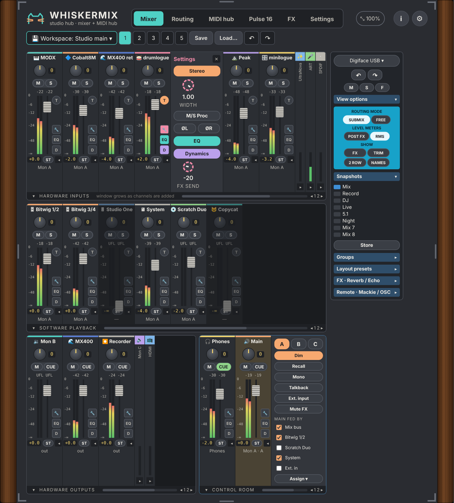

# WhiskerMix

A TotalMix-style mixer and studio hub for Linux, by Studio 87. Made for one setup: an **RME Digiface USB** with a **Ferrofish Pulse 16 DX** behind it on ADAT. Mixer, routing, MIDI hub, Pulse 16 control page, built-in FX. Free and open source. Windows and macOS builds exist for the audio side.

 Screenshot of the interactive mockup in docs/mockups.

**Manual:** [PDF, opens in the browser](https://github.com/SpeakingColors/whiskermix/blob/main/docs/whiskermix-manual.pdf)

## What to expect
- **Tested only with the Digiface USB and the Pulse 16 DX.** No promise it works with anything else. Other RME interfaces may work for the audio part and may or may not for the hardware mixer; you are free to try and to report what you see.
- **The mixer is a blend.** Faders, pan, phase, stereo link, M/S, main volume, dim and speaker B are written to the Digiface's own hardware mixer over USB (the messages the vendor mixer sends, learned from captures). Everything the hardware does not do over USB (mute, solo, width, EQ, compressor, reverb, delay, pitch shift) runs on the computer through the audio system: PipeWire or JACK on Linux, the system audio or ASIO on Windows and macOS. If no Digiface is found, the hardware part goes into dry run and the software part keeps working.
- **Pulse 16** is controlled over DIN MIDI SysEx through any class compliant MIDI interface. RemoteFish is not needed.
- **Offline.** No telemetry, no update checks. A button in Settings opens this page.
- Status: test builds. The hardware mixer code is built from captures and unit tests; the first run on real hardware is still ahead (see the roadmap).

## Download
Releases carry one zip with a folder per system (linux, windows, macos), each with the app, the plugins, INSTALL.txt and the manual. Pre-releases are test builds.

## Docs
- [Manual](docs/MANUAL.md)
- [Architecture](docs/ARCHITECTURE.md)
- [Digiface USB protocol notes](docs/DIGIFACE-PROTOCOL.md) and [Pulse 16 protocol notes](docs/PULSE16-PROTOCOL.md): what is decoded, what is still missing, and which captures would help
- [Interactive mockups](docs/README.md)
- [Roadmap](ROADMAP.md)

## Help fill in the protocol
If you own a Digiface USB and Windows, short USBPcap captures of the vendor mixer doing one thing at a time (a fader on input 3, a playback fader, a hardware output fader, a steady tone for the meters) would complete the hardware part. The wish list is at the end of [docs/DIGIFACE-PROTOCOL.md](docs/DIGIFACE-PROTOCOL.md). Open an issue with the capture attached and a one-line note of what you did.

## Build
Core (no dependencies): `sh tests/run.sh`. App: CMake, JUCE 8 in `third_party/JUCE`, `-DWM_BUILD_APP=ON`; Linux needs `libpipewire-0.3-dev` and `libusb-1.0-0-dev`. Windows and macOS: add `-DWM_WINDOWS_TEST=ON` (JUCE audio, no USB).

## License
AGPL-3.0-or-later, see [LICENSE](LICENSE).

Not affiliated with or endorsed by RME, Ferrofish or any other maker named here. All trademarks belong to their owners.

## Support

  

☕ Free and open source, made by one person. If it helps your music, a coffee on [Ko-fi](https://ko-fi.com/studio87) keeps it coming. 💜
